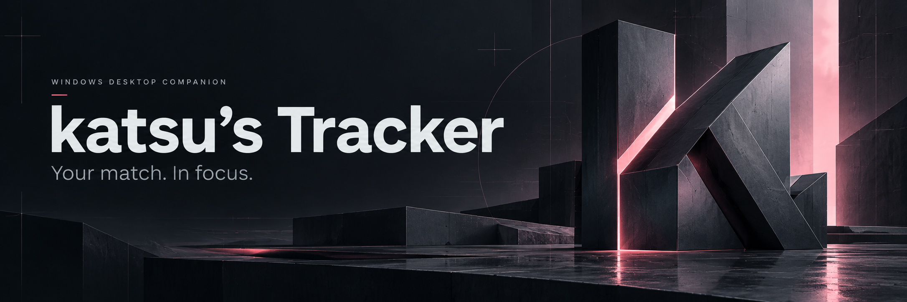
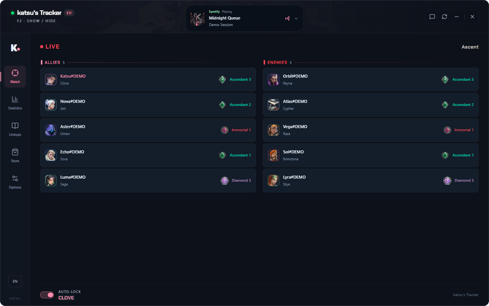
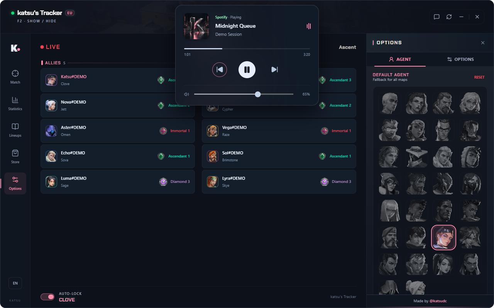

<p align="center">
  
</p>

<p align="center">
  <strong>A focused VALORANT companion for Windows.</strong><br>
  Live ranks. Agent presets. A visual Spike timer. Your music, within reach.
</p>

<p align="center">
  <a href="https://github.com/katsudc/katsu-tracker-releases/releases/latest"></a>
  
  <a href="LICENSE"></a>
</p>

<p align="center">
  <a href="https://github.com/katsudc/katsu-tracker-releases/releases/latest/download/Katsu-Tracker-setup.exe"><strong>Download for Windows</strong></a>
  &nbsp;·&nbsp; <a href="#features">Features</a>
  &nbsp;·&nbsp; <a href="#a-closer-look">Screenshots</a>
  &nbsp;·&nbsp; <a href="docs/GETTING_STARTED.md">Get started</a>
  &nbsp;·&nbsp; <a href="SUPPORT.md">Support</a>
</p>

---

## Your match, at a glance

Keep player names, agents and available ranks in one clean view. Set your preferred agents by map, bring Spotify controls closer, and keep the Spike countdown readable without filling your screen.

Your personal match history stays useful between games. Preferences are saved automatically, so you can open the app and get back to playing.

## Features

| Feature | What it brings to your setup |
| :--- | :--- |
| **Live match overview** | Both teams, available player identities, agents and rank icons. Confirmed unranked accounts and unavailable ranks have distinct labels. |
| **Agent presets** | A default agent, map-specific choices and a configurable automatic-lock delay. |
| **Visual Spike timer** | A compact countdown triggered by the planted-Spike HUD icon, displayed on the game monitor and reset when the round ends. Drag, resize and restyle it in a saved visual editor. |
| **Spotify mini-player** | Track information, artwork, progress, previous/play/next and Spotify-only volume in an expandable player. |
| **Personal history & insights** | Your last 5, 10 or 20 accessible Competitive matches, personal performance trends and agent/map breakdowns. |
| **Community lineups** | Browse Tracker.gg guides with agent, map and attack/defense filters. |
| **Make it yours** | Five accent themes, English and Turkish UI, saved settings and a movable desktop window. |
| **Verified updates** | Startup checks, one-click signed downloads with progress, silent installation and automatic restart while VALORANT is closed. |

[Explore the features →](docs/FEATURES.md)

## A closer look

### A cleaner live match view



### Set your agent. Keep your music close.



<sub>Application previews use sample player and music data. The interface is rendered from the actual application; generated artwork is used for the cover and brand mark.</sub>

## Get started

1. [Download the latest Windows installer](https://github.com/katsudc/katsu-tracker-releases/releases/latest/download/Katsu-Tracker-setup.exe).
2. Install and launch **katsu's Tracker**.
3. Open Riot Client and VALORANT normally. The tracker connects to the existing session.
4. Press **F2** to show or hide the main window. Choose your agent preferences and theme in **Options**.

The overlay follows the physical game viewport across resolutions and monitors. Windows must compose external windows over the game; **Borderless Windowed / Windowed Fullscreen** is the most reliable mode. True exclusive fullscreen can hide external overlays. The visual Spike detector needs the HUD to remain visible. To use music controls, play a track in the Windows Spotify desktop app.

[Installation & setup](docs/GETTING_STARTED.md) · [Troubleshooting](docs/TROUBLESHOOTING.md)

## Data, kept in context

- Live match cards show **identity, agent and rank**. Opponent performance scouting is outside the current feature set.
- Ranks come from the existing Riot session's match data and MMR responses. Unknown ranks are labelled as unavailable.
- Personal statistics cover up to **20 accessible Competitive matches**. Missing fields stay unavailable; cached results remain visible if a refresh fails.
- No external player-statistics account or API key is required.
- Spotify controls use the Windows desktop media session. Lineup content is served by Tracker.gg.

[Privacy & network details](docs/PRIVACY.md)

## Updates & feedback

At startup, the app shows its update check. When a release is available, choose **Update now** with VALORANT closed. The app displays download progress, verifies the updater signature, installs quietly and restarts automatically. Preferences are preserved. Versions older than 1.9.6-personal.36 use their previous update flow once to reach this version.

Found something to improve? [Report a bug](https://github.com/katsudc/katsu-tracker-releases/issues/new?template=bug_report.yml) or [suggest a feature](https://github.com/katsudc/katsu-tracker-releases/issues/new?template=feature_request.yml).

[Release notes](CHANGELOG.md) · [Contributing](CONTRIBUTING.md) · [Security](SECURITY.md) · [Brand assets](docs/BRAND_ASSETS.md)

## Build from source

The desktop application uses **Rust + Tauri 2**, **TypeScript + React**, and **CSS + Tailwind**. Build on Windows x64 with Node.js, pnpm 11.24.0, stable Rust, Microsoft C++ Build Tools and the Windows SDK:

```powershell
git clone https://github.com/katsudc/katsu-tracker-releases.git
cd katsu-tracker-releases
pnpm install --frozen-lockfile
pnpm exec tauri dev
```

[Windows build & architecture guide](docs/BUILDING.md) · [Contribution guide](CONTRIBUTING.md)

## Project & license

<p align="center"></p>

Created and maintained by **[katsu](https://github.com/katsudc)**. Licensed under the [MIT License](LICENSE).

The application source, public downloads, documentation and issue tracking are available in this repository. GitHub’s **Languages** panel calculates the language breakdown from the tracked source; vendored dependencies and generated fixtures are excluded.

Independent community project. Not affiliated with Riot Games, Spotify or Tracker Network. Third-party names and artwork belong to their respective owners.
